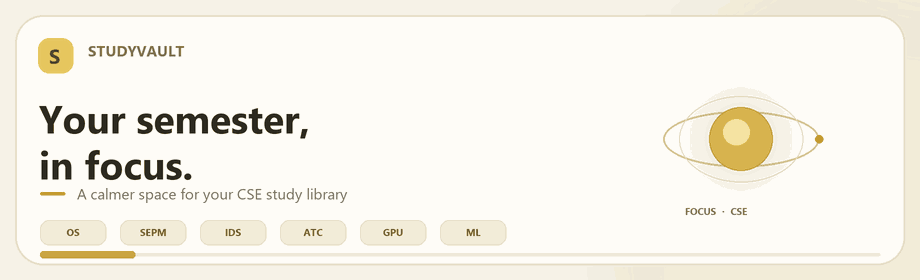

<div align="center">



# StudyVault

**A focused, animated home for a CSE semester library.**

[🌐 Open the live StudyVault demo](https://studyvault-cse-ih69.onrender.com)

[](https://www.python.org/)
[](https://fastapi.tiangolo.com/)
[](#responsive-by-design)

</div>

StudyVault organizes modules, past papers, mid-semester materials, and exam dates in one lightweight interface. The live demo includes the CSE study files bundled with this repository.

## What’s inside

- A cinematic dashboard with subject summaries and exam runway
- Subject library, PYQ explorer, and exam timetable
- Inline PDF preview, slide-text preview, and separate downloads
- Scroll reveals, pointer light, card depth, magnetic controls, and subtle interaction sparks
- Phone-first bottom navigation, tablet layouts, and reduced-motion support
- FastAPI backend with a small local SQLite index

## Run locally

Use Python 3.10 or later. From the project root:

```powershell
python -m pip install -r 05_Web_Application/requirements.txt
Set-Location 05_Web_Application
python -m uvicorn server:app --host 127.0.0.1 --port 8765
```

Then open [http://127.0.0.1:8765](http://127.0.0.1:8765). Keep your course materials in the matching `01_Subjects/<subject>/Modules`, `PYQs`, and `Mid_Sem` folders; use **Manage files → Rescan library** after adding files.

## Responsive by design

At phone widths the navigation becomes a thumb-friendly bottom dock, stats use a compact two-column layout, and filters scroll horizontally. Tablet widths keep the sidebar while balancing the content grid. Safe-area insets and touch input are handled, and hover-only effects stay off touch screens.

## Motion with care

The UI uses local CSS and a small amount of delegated JavaScript. It respects `prefers-reduced-motion`, avoids animation libraries, and keeps scroll work frame-limited.

## Deploy a public demo

**Live app:** [studyvault-cse-ih69.onrender.com](https://studyvault-cse-ih69.onrender.com)

[](https://render.com/deploy?repo=https://github.com/shivubuilds-mikasa/StudyVault)

The included `render.yaml` creates a free Singapore web service from this repository. It serves the included CSE study library. Free Render services spin down after 15 minutes without traffic, so the first visit after a quiet period may take a little longer.

## Included study library

This public repository includes the CSE PDFs and presentation files in `01_Subjects/`, `02_Examination/`, and `03_Unclassified/`; anyone can view and download them from GitHub or the live app. The app has no login. Keep private or sensitive materials out of those folders before pushing changes. Local database files, backups, inventories, and verification records remain excluded from Git.

## Stack

Python · FastAPI · SQLite · HTML · CSS · JavaScript
